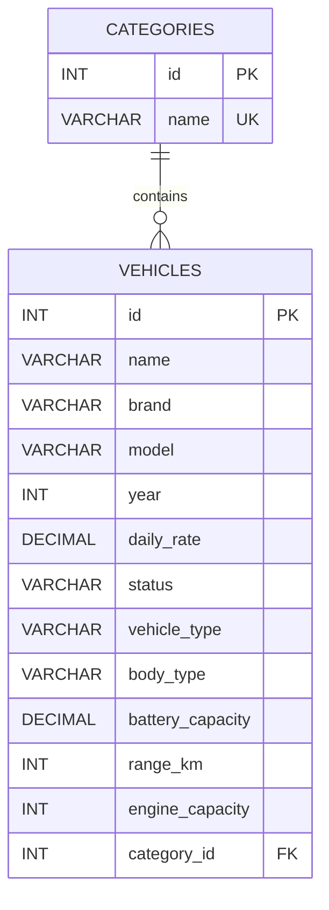

# Java.lab

## Лабораторна робота №10: Використання Maven та JDBC для роботи з базою даних

### 1. Опис проєкту

Програма є консольним застосунком для системи прокату транспортних засобів.

У лабораторній роботі №10 реалізовано підключення до реляційної бази даних MySQL за допомогою JDBC та використання Maven для керування залежностями і збирання проєкту.

Дані про транспортні засоби та їхні категорії зберігаються в базі даних. Реалізовано основні операції додавання, пошуку, оновлення, видалення та сортування записів.

### 2. Мета роботи

- Ознайомитися з інструментом збирання проєктів Maven.
- Навчитися підключати JDBC-драйвер.
- Отримати практичні навички роботи з реляційною базою даних MySQL.
- Реалізувати CRUD-операції за допомогою SQL-запитів.
- Навчитися використовувати транзакції.
- Ознайомитися із захистом від SQL Injection.

### 3. Використані технології

- Java 25
- Maven
- MySQL
- JDBC
- MySQL Connector/J
- IntelliJ IDEA

### 4. Структура проєкту

```text
lab1/
│
├── src/
│   └── main/
│       ├── java/
│       │   ├── CarRental.java
│       │   ├── DBConnection.java
│       │   ├── DatabaseInitializer.java
│       │   ├── TransactionDemo.java
│       │   └── SqlInjectionDemo.java
│       │
│       └── resources/
│           ├── application.properties
│           └── init.sql
│
├── pom.xml
├── README.md
└── .gitignore
```

### 5. Налаштування Maven

Для керування проєктом використовується Maven.

У файлі `pom.xml` вказано:

- GroupId: `ua.college`
- ArtifactId: `car-rental`
- Version: `1.0-SNAPSHOT`
- Версія Java: `25`
- Залежність MySQL Connector/J версії `9.5.0`.

Стандартна структура Maven-проєкту використовується для розміщення Java-класів та ресурсів.

### 6. Структура бази даних

Назва бази даних: `car_rental`.

У базі даних створено дві таблиці: `categories` та `vehicles`.

#### Таблиця categories

| Поле | Тип | Опис |
|---|---|---|
| id | INT | Первинний ключ, автоматичне збільшення |
| name | VARCHAR(100) | Назва категорії, унікальне значення |

#### Таблиця vehicles

| Поле | Тип | Опис |
|---|---|---|
| id | INT | Первинний ключ |
| name | VARCHAR(150) | Назва транспортного засобу |
| brand | VARCHAR(100) | Марка |
| model | VARCHAR(100) | Модель |
| year | INT | Рік випуску |
| daily_rate | DECIMAL(10,2) | Вартість оренди за день |
| status | VARCHAR(50) | Статус |
| vehicle_type | VARCHAR(50) | Тип транспорту |
| body_type | VARCHAR(100) | Тип кузова |
| battery_capacity | DECIMAL(10,2) | Ємність батареї |
| range_km | INT | Запас ходу |
| engine_capacity | INT | Об'єм двигуна |
| category_id | INT | Зовнішній ключ категорії |

Для таблиць використовуються первинні ключі, обмеження `NOT NULL`, `UNIQUE`, `CHECK` та зовнішній ключ.

### 7. Зв'язок між таблицями

Між таблицями `categories` та `vehicles` реалізовано зв'язок один-до-багатьох.

Одна категорія може містити декілька транспортних засобів, але кожен транспортний засіб належить до однієї категорії.

#### ER-діаграма



Для зовнішнього ключа використано `ON DELETE RESTRICT`.

Це означає, що категорію не можна видалити, якщо до неї прив'язані транспортні засоби. Таким чином забезпечується цілісність даних.

### 8. Підключення до бази даних

Для підключення до MySQL створено клас `DBConnection`.

У ньому використано патерн Singleton, який забезпечує єдиний екземпляр класу з налаштуваннями підключення.

Параметри підключення зберігаються у файлі `application.properties`:

```properties
db.url=jdbc:mysql://localhost:3306/car_rental
db.username=root
db.password=YOUR_PASSWORD
```

Пароль потрібно замінити на власний.

Для створення підключення використовується `DriverManager.getConnection()`.

Кожне отримане підключення закривається після завершення роботи з ним за допомогою `try-with-resources`.

### 9. Ініціалізація бази даних

У файлі `init.sql` описано створення таблиць та початкове наповнення категорій.

Для уникнення повторного створення таблиць використовується `CREATE TABLE IF NOT EXISTS`.

Початкові категорії додаються за допомогою `INSERT IGNORE`, тому повторний запуск не створює дублікати категорій.

Клас `DatabaseInitializer` автоматично виконує SQL-скрипт під час запуску програми.

### 10. Реалізовані операції JDBC

Для роботи з таблицею транспортних засобів реалізовано такі операції:

- `findById()` — пошук транспортного засобу за ідентифікатором.
- `save()` — додавання нового або оновлення наявного запису.
- `delete()` — видалення транспортного засобу.
- `findAll()` — отримання всіх транспортних засобів.
- `findAllSortedByName()` — отримання записів із сортуванням за назвою.

Для сортування використовується SQL-команда:

```sql
SELECT * FROM vehicles ORDER BY name ASC;
```

Для перетворення результатів SQL-запиту на об'єкти Java використовується окремий метод `mapRow(ResultSet)`.

Якщо транспортний засіб із заданим ID не знайдено, генерується `EntityNotFoundException`.

Для виконання параметризованих SQL-запитів використовується `PreparedStatement`.

### 11. Транзакції

Для демонстрації роботи з транзакціями створено клас `TransactionDemo`.

У програмі реалізовано два приклади.

**Commit**

Метод `demonstrateCommit()` демонструє підтвердження транзакції. Після виконання SQL-операції викликається `commit()`, що зберігає зміни в базі даних.

Після перевірки тимчасова категорія видаляється.

**Rollback**

Метод `demonstrateRollback()` демонструє скасування транзакції.

Під час виконання створюється нова категорія та транспортний засіб, після чого навмисно викликається помилка.

Завдяки `rollback()` усі зміни цієї транзакції скасовуються.

Основні команди:

```java
connection.setAutoCommit(false);
connection.commit();
connection.rollback();
```

### 12. Захист від SQL Injection

Для демонстрації SQL Injection створено клас `SqlInjectionDemo`.

У програмі використовується безпечний підхід із `PreparedStatement`.

Приклад безпечного запиту:

```java
String sql = "SELECT * FROM vehicles WHERE name = ?";

PreparedStatement statement = connection.prepareStatement(sql);
statement.setString(1, name);
```

Небезпечний варіант із використанням `Statement` та конкатенації рядків:

```java
String sql = "SELECT * FROM vehicles WHERE name = '" + name + "'";

Statement statement = connection.createStatement();
ResultSet resultSet = statement.executeQuery(sql);
```

У небезпечному варіанті введені користувачем дані можуть змінити структуру SQL-запиту.

Тому в основній програмі використовується `PreparedStatement`, який передає значення параметрів окремо від SQL-команди.

### 13. Налаштування та запуск проєкту

Для запуску необхідно встановити:

- JDK 25;
- Maven;
- MySQL Server;
- IntelliJ IDEA або інше середовище розробки Java.

#### Крок 1. Створення бази даних

У MySQL Workbench виконати:

```sql
CREATE DATABASE IF NOT EXISTS car_rental
CHARACTER SET utf8mb4
COLLATE utf8mb4_unicode_ci;
```

#### Крок 2. Налаштування підключення

Створити файл `src/main/resources/application.properties` та вказати власні параметри:

```properties
db.url=jdbc:mysql://localhost:3306/car_rental
db.username=root
db.password=YOUR_PASSWORD
```

#### Крок 3. Завантаження залежностей

Відкрити проєкт у IntelliJ IDEA та дочекатися завантаження Maven-залежностей.

#### Крок 4. Компіляція

У терміналі виконати:

```bash
mvn clean compile
```

#### Крок 5. Запуск

Для запуску програми через Maven:

```bash
mvn exec:java
```

Також програму можна запустити безпосередньо через IntelliJ IDEA, використовуючи клас `CarRental`.

Під час запуску автоматично виконується ініціалізація бази даних.

### 14. Висновок

Під час виконання лабораторної роботи було освоєно використання Maven для керування проєктом та JDBC для роботи з реляційною базою даних MySQL.

Було реалізовано підключення до бази даних, CRUD-операції, зв'язок між таблицями, сортування даних, обробку помилок, транзакції та захист від SQL Injection за допомогою `PreparedStatement`.

Отримані навички дозволяють створювати Java-застосунки, які зберігають та обробляють дані у реляційних базах даних.